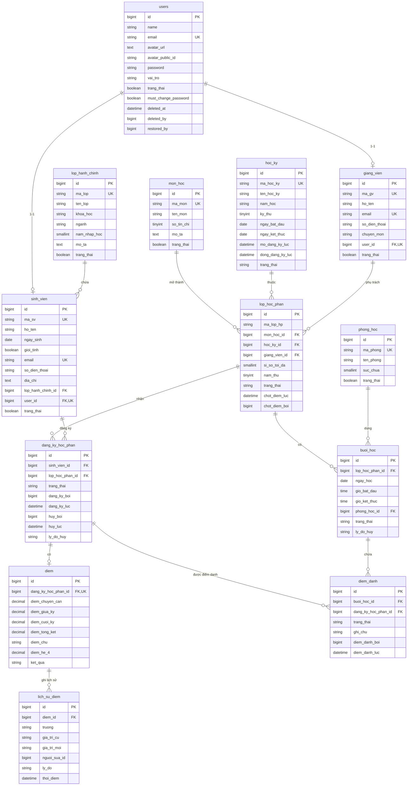

# 03 — Thiết kế dữ liệu

**Database:** MySQL 8 · **Charset:** `utf8mb4` · **Collation:** `utf8mb4_unicode_ci` · **Timezone:** `Asia/Ho_Chi_Minh`

Tài liệu này là nguồn chân lý cho schema. Mọi thay đổi bảng/cột phải cập nhật file này cùng commit với migration.

---

## 1. ERD



---

## 2. Quy ước đặt tên

- Tên bảng và cột: **tiếng Việt không dấu, snake_case, số ít** (`sinh_vien`, `lop_hoc_phan`). Model khai báo `protected $table` tường minh vì Laravel mặc định plural tiếng Anh.
- Khóa ngoại: `<ten_bang>_id`.
- Giá trị enum: **tiếng Anh in hoa** (`ACTIVE`, `OPEN`, `SCHEDULED`...) để khớp hợp đồng API và FE.
- Mọi bảng nghiệp vụ có `created_at`, `updated_at`.
- Bảng xóa mềm có thêm `deleted_at`, `deleted_by`, `restored_by`.

---

## 3. Chi tiết bảng

### 3.1. `users`

| Cột | Kiểu | Null | Mặc định | Ghi chú |
|---|---|---|---|---|
| id | bigint unsigned | PK | auto | |
| name | varchar(255) | no | | Họ tên hiển thị |
| email | varchar(255) | no | | **unique**, dùng để đăng nhập |
| avatar_url | text | yes | null | URL Cloudinary. `null` = hiển thị chữ cái đầu tên |
| avatar_public_id | varchar(255) | yes | null | `public_id` trên Cloudinary, cần để xóa ảnh cũ |
| email_verified_at | timestamp | yes | null | |
| password | varchar(255) | no | | bcrypt |
| vai_tro | varchar(20) | no | `SINH_VIEN` | `ADMIN`, `GIANG_VIEN`, `SINH_VIEN` |
| trang_thai | boolean | no | true | false = khóa tài khoản |
| must_change_password | boolean | no | true | Bắt đổi mật khẩu lần đầu |
| remember_token | varchar(100) | yes | null | |
| deleted_at | timestamp | yes | null | |
| deleted_by | bigint unsigned | yes | null | FK `users.id`, `nullOnDelete` |
| restored_by | bigint unsigned | yes | null | FK `users.id`, `nullOnDelete` |
| created_at, updated_at | timestamp | yes | null | |

**Index:** `unique(email)`, `index(vai_tro)`, `index(trang_thai)`, `index(deleted_at)`.

> `email` unique toàn hệ thống. `sinh_vien.email` và `giang_vien.email` unique trong bảng của mình **và** phải kiểm tra trùng với `users.email` ở tầng service (không thể đặt unique xuyên bảng ở MySQL).

### 3.2. `sinh_vien`

| Cột | Kiểu | Null | Ghi chú |
|---|---|---|---|
| id | bigint unsigned | PK | |
| ma_sv | varchar(50) | no | **unique**, không dùng lại mã đã xóa |
| ho_ten | varchar(255) | no | |
| ngay_sinh | date | yes | |
| gioi_tinh | boolean | no | true = Nam |
| email | varchar(255) | no | **unique** trong bảng; unique xuyên bảng với `users.email` |
| so_dien_thoai | varchar(20) | yes | |
| dia_chi | text | yes | |
| lop_hanh_chinh_id | bigint unsigned | yes | FK `lop_hanh_chinh.id`, `nullOnDelete` |
| user_id | bigint unsigned | no | **unique**, FK `users.id`, `cascadeOnDelete` |
| trang_thai | boolean | no | mặc định true |
| deleted_at | timestamp | yes | |
| deleted_by | bigint unsigned | yes | |
| restored_by | bigint unsigned | yes | |
| created_at, updated_at | timestamp | yes | |

**Index:** `unique(ma_sv)`, `unique(email)`, `unique(user_id)`, `index(lop_hanh_chinh_id)`, `index(trang_thai)`, `index(deleted_at)`, `index(ho_ten)`.

### 3.3. `giang_vien`

| Cột | Kiểu | Null | Ghi chú |
|---|---|---|---|
| id | bigint unsigned | PK | |
| ma_gv | varchar(50) | no | **unique** |
| ho_ten | varchar(255) | no | |
| email | varchar(255) | no | **unique**, đồng bộ `users.email` |
| so_dien_thoai | varchar(20) | yes | |
| chuyen_mon | varchar(255) | yes | |
| user_id | bigint unsigned | no | **unique**, FK `users.id`, cascade |
| trang_thai | boolean | no | |
| deleted_at, deleted_by, restored_by | | yes | |
| created_at, updated_at | timestamp | yes | |

**Index:** `unique(ma_gv)`, `unique(email)`, `unique(user_id)`, `index(trang_thai)`, `index(deleted_at)`.

### 3.4. `lop_hanh_chinh`

| Cột | Kiểu | Null | Ghi chú |
|---|---|---|---|
| id | bigint unsigned | PK | |
| ma_lop | varchar(20) | no | **unique** |
| ten_lop | varchar(255) | no | |
| khoa_hoc | varchar(20) | yes | **Khóa** (cohort, năm nhập học), ví dụ `K65`. Không phải khoa/faculty |
| nganh | varchar(20) | yes | Ngành, ví dụ `CNTT`, `KTPM`. Chỉ để lọc/thống kê |
| nam_nhap_hoc | smallint unsigned | yes | Năm nhập học, ví dụ `2023`. Dùng tính `nam_thu` |
| mo_ta | text | yes | |
| trang_thai | boolean | no | |
| deleted_at, deleted_by, restored_by | | yes | |
| created_at, updated_at | timestamp | yes | |

**Index:** `unique(ma_lop)`, `index(khoa_hoc)`, `index(nganh)`, `index(trang_thai)`, `index(deleted_at)`.

> Tên cột là `khoa_hoc` (khóa) để không nhập nhằng với **khoa** (faculty) — xem ADR-016.
> Hệ thống **không** có bảng khoa (faculty) hay chương trình đào tạo. `nganh` chỉ là nhãn tự do để lọc.

### 3.5. `mon_hoc`

| Cột | Kiểu | Null | Ghi chú |
|---|---|---|---|
| id | bigint unsigned | PK | |
| ma_mon | varchar(20) | no | **unique** |
| ten_mon | varchar(255) | no | |
| so_tin_chi | tinyint unsigned | no | 1–10 (validate app) |
| mo_ta | text | yes | |
| trang_thai | boolean | no | |
| deleted_at, deleted_by, restored_by | | yes | |
| created_at, updated_at | timestamp | yes | |

### 3.6. `hoc_ky`

| Cột | Kiểu | Null | Ghi chú |
|---|---|---|---|
| id | bigint unsigned | PK | |
| ma_hoc_ky | varchar(20) | no | **unique**, ví dụ `2026-1` |
| ten_hoc_ky | varchar(255) | no | |
| nam_hoc | varchar(9) | no | Ví dụ `2026-2027`. Dùng tính năm thứ |
| ky_thu | tinyint unsigned | no | 1, 2 hoặc 3 (học kỳ hè) |
| ngay_bat_dau | date | no | |
| ngay_ket_thuc | date | no | phải > `ngay_bat_dau` |
| mo_dang_ky_luc | datetime | no | |
| dong_dang_ky_luc | datetime | no | phải > `mo_dang_ky_luc` |
| trang_thai | varchar(20) | no | `UPCOMING`, `ONGOING`, `CLOSED` |
| deleted_at, deleted_by, restored_by | | yes | |
| created_at, updated_at | timestamp | yes | |

**Index:** `unique(ma_hoc_ky)`, `unique(nam_hoc, ky_thu)`, `index(trang_thai)`, `index(ngay_bat_dau)`.

> **Vòng đời chỉ tiến** (BR-24): `UPCOMING → ONGOING → CLOSED`; `CLOSED` không quay lại. Chỉ một kỳ `ONGOING` tại một thời điểm.
> Hai học kỳ không chồng lấn `[ngay_bat_dau, ngay_ket_thuc]`; đợt đăng ký phải nằm trong khoảng ngày của kỳ (BR-25).
> Học kỳ `CLOSED` không được xóa (FR-06.04).

### 3.7. `phong_hoc`

| Cột | Kiểu | Null | Ghi chú |
|---|---|---|---|
| id | bigint unsigned | PK | |
| ma_phong | varchar(20) | no | **unique** |
| ten_phong | varchar(255) | no | |
| suc_chua | smallint unsigned | no | > 0 |
| trang_thai | boolean | no | |
| deleted_at, deleted_by, restored_by | | yes | |
| created_at, updated_at | timestamp | yes | |

### 3.8. `lop_hoc_phan`

| Cột | Kiểu | Null | Ghi chú |
|---|---|---|---|
| id | bigint unsigned | PK | |
| ma_lop_hp | varchar(30) | no | unique theo học kỳ |
| mon_hoc_id | bigint unsigned | no | FK `mon_hoc.id`, `restrictOnDelete` |
| hoc_ky_id | bigint unsigned | no | FK `hoc_ky.id`, `restrictOnDelete` |
| giang_vien_id | bigint unsigned | no | FK `giang_vien.id`, `restrictOnDelete` |
| si_so_toi_da | smallint unsigned | no | > 0 |
| nam_thu | tinyint unsigned | yes | Năm thứ lớp phục vụ (1–6). `null` = mọi năm. Xem BR-23 |
| trang_thai | varchar(20) | no | `OPEN`, `CLOSED`, `CANCELLED` |
| chot_diem_luc | datetime | yes | null = chưa chốt |
| chot_diem_boi | bigint unsigned | yes | FK `users.id`, `nullOnDelete` |
| deleted_at, deleted_by, restored_by | | yes | |
| created_at, updated_at | timestamp | yes | |

**Index:** `unique(hoc_ky_id, ma_lop_hp)`, `index(mon_hoc_id)`, `index(giang_vien_id)`, `index(nam_thu)`, `index(trang_thai)`, `index(deleted_at)`.

> `unique(hoc_ky_id, ma_lop_hp)` **không** lọc `deleted_at`, nên bản ghi xóa mềm vẫn giữ chỗ mã — đúng BR-01.
> Không lưu `si_so_hien_tai`; tính bằng `count` đăng ký ACTIVE (tránh lệch dữ liệu).
> `nam_thu` là ràng buộc **thô** ở cấp lớp, không thay thế chương trình đào tạo (ADR-016). Môn đại cương phục vụ nhiều năm thì để `null`.

### 3.9. `buoi_hoc`

| Cột | Kiểu | Null | Ghi chú |
|---|---|---|---|
| id | bigint unsigned | PK | |
| lop_hoc_phan_id | bigint unsigned | no | FK `lop_hoc_phan.id`, cascade |
| ngay_hoc | date | no | |
| gio_bat_dau | time | no | |
| gio_ket_thuc | time | no | > `gio_bat_dau` |
| phong_hoc_id | bigint unsigned | no | FK `phong_hoc.id`, `restrictOnDelete` |
| trang_thai | varchar(20) | no | `SCHEDULED`, `DONE`, `CANCELLED` |
| ly_do_huy | varchar(255) | yes | |
| deleted_at, deleted_by, restored_by | | yes | |
| created_at, updated_at | timestamp | yes | |

**Index:** `index(lop_hoc_phan_id, ngay_hoc)`, `index(phong_hoc_id, ngay_hoc)`, `index(ngay_hoc)`, `index(trang_thai)`, `index(deleted_at)`.

> **Định nghĩa "chưa diễn ra":** `trang_thai = 'SCHEDULED'` **và** `ngay_hoc` + `gio_ket_thuc` > thời điểm hiện tại.
> **Conflict giảng viên** kiểm tra qua join `lop_hoc_phan.giang_vien_id` (không lưu lặp `giang_vien_id` trên `buoi_hoc`).

### 3.10. `dang_ky_hoc_phan`

| Cột | Kiểu | Null | Ghi chú |
|---|---|---|---|
| id | bigint unsigned | PK | |
| sinh_vien_id | bigint unsigned | no | FK `sinh_vien.id`, `restrictOnDelete` |
| lop_hoc_phan_id | bigint unsigned | no | FK `lop_hoc_phan.id`, `restrictOnDelete` |
| trang_thai | varchar(20) | no | `ACTIVE`, `CANCELLED` |
| dang_ky_boi | bigint unsigned | no | FK `users.id` |
| dang_ky_luc | datetime | no | |
| huy_boi | bigint unsigned | yes | FK `users.id` |
| huy_luc | datetime | yes | |
| ly_do_huy | varchar(255) | yes | |
| created_at, updated_at | timestamp | yes | |

**Index:** `unique(sinh_vien_id, lop_hoc_phan_id)`, `index(lop_hoc_phan_id, trang_thai)`, `index(sinh_vien_id, trang_thai)`, `index(dang_ky_luc)`.

> Không dùng soft delete. Hủy = `CANCELLED`. Đăng ký lại = cập nhật chính dòng này về `ACTIVE` (BR-20).
> **Danh sách điểm danh tại buổi X:** đăng ký có `dang_ky_luc <= thời điểm buổi học` và (`huy_luc` null hoặc `huy_luc > thời điểm buổi học`).
> **Đăng ký lại bị chặn khi dòng đã có `diem`** (409 `HAS_GRADE_OR_ATTENDANCE`, BR-27) — tránh hồi sinh điểm cũ. `diem_danh` cũ giữ nguyên nhưng không tính vào chuyên cần vì buổi đó nằm trước `dang_ky_luc` mới (§5.3).

### 3.11. `diem_danh`

| Cột | Kiểu | Null | Ghi chú |
|---|---|---|---|
| id | bigint unsigned | PK | |
| buoi_hoc_id | bigint unsigned | no | FK `buoi_hoc.id`, cascade |
| dang_ky_hoc_phan_id | bigint unsigned | no | FK `dang_ky_hoc_phan.id`, cascade |
| trang_thai | varchar(20) | no | `PRESENT`, `LATE`, `ABSENT`, `EXCUSED` |
| ghi_chu | varchar(255) | yes | |
| diem_danh_boi | bigint unsigned | no | FK `users.id` |
| diem_danh_luc | datetime | no | |
| created_at, updated_at | timestamp | yes | |

**Index:** `unique(buoi_hoc_id, dang_ky_hoc_phan_id)`, `index(dang_ky_hoc_phan_id)`.

### 3.12. `diem`

| Cột | Kiểu | Null | Ghi chú |
|---|---|---|---|
| id | bigint unsigned | PK | |
| dang_ky_hoc_phan_id | bigint unsigned | no | **unique**, FK cascade |
| diem_chuyen_can | decimal(4,2) | yes | 0.00–10.00 |
| diem_giua_ky | decimal(4,2) | yes | |
| diem_cuoi_ky | decimal(4,2) | yes | |
| diem_tong_ket | decimal(4,2) | yes | Tính tự động |
| diem_chu | varchar(2) | yes | `A`, `B`, `C`, `D`, `F` |
| diem_he_4 | decimal(3,2) | yes | 0.00–4.00, suy ra từ `diem_chu` |
| ket_qua | varchar(20) | yes | `DAT`, `KHONG_DAT` |
| created_at, updated_at | timestamp | yes | |

**Index:** `unique(dang_ky_hoc_phan_id)`, `index(ket_qua)`, `index(diem_chu)`.

> `diem_tong_ket`, `diem_chu`, `diem_he_4`, `ket_qua` chỉ có giá trị khi đủ 3 điểm thành phần; ngược lại null.
> Công thức và bảng quy đổi đọc từ `cau_hinh`, không hard-code.

### 3.13. `lich_su_diem`

| Cột | Kiểu | Null | Ghi chú |
|---|---|---|---|
| id | bigint unsigned | PK | |
| diem_id | bigint unsigned | no | FK `diem.id`, cascade |
| truong | varchar(30) | no | `diem_chuyen_can`, `diem_giua_ky`, `diem_cuoi_ky`, `diem_tong_ket`, `diem_chu`, `diem_he_4`, `ket_qua` |
| gia_tri_cu | varchar(50) | yes | |
| gia_tri_moi | varchar(50) | yes | |
| nguoi_sua_id | bigint unsigned | no | FK `users.id` |
| ly_do | varchar(255) | yes | |
| thoi_diem | datetime | no | |

**Index:** `index(diem_id, thoi_diem)`.

### 3.14. `cau_hinh`

| Cột | Kiểu | Null | Ghi chú |
|---|---|---|---|
| id | bigint unsigned | PK | |
| khoa | varchar(100) | no | **unique**, ví dụ `diem.trong_so` |
| gia_tri | json | no | |
| mo_ta | varchar(255) | yes | |
| created_at, updated_at | timestamp | yes | |

**Giá trị mặc định:**

```json
{
  "diem.trong_so": { "chuyen_can": 0.25, "giua_ky": 0.25, "cuoi_ky": 0.50 },
  "diem.bang_quy_doi": [
    { "tu": 8.5,  "den": 10.0, "chu": "A",  "he_4": 4.0, "dat": true },
    { "tu": 7.0,  "den": 8.49, "chu": "B",  "he_4": 3.0, "dat": true },
    { "tu": 5.5,  "den": 6.99, "chu": "C",  "he_4": 2.0, "dat": true },
    { "tu": 4.0,  "den": 5.49, "chu": "D",  "he_4": 1.0, "dat": true },
    { "tu": 0.0,  "den": 3.99, "chu": "F",  "he_4": 0.0, "dat": false }
  ],
  "diem.diem_danh.sua_trong_so_ngay": 7
}
```

### 3.15. `nhat_ky`

| Cột | Kiểu | Null | Ghi chú |
|---|---|---|---|
| id | bigint unsigned | PK | |
| doi_tuong_loai | varchar(50) | no | `users`, `lop_hoc_phan`, `diem`, ... |
| doi_tuong_id | bigint unsigned | no | |
| hanh_dong | varchar(50) | no | `TAO`, `CAP_NHAT`, `XOA`, `KHOI_PHUC`, `KHOA`, `MO_KHOA`, `DOI_TRANG_THAI`, `CHOT_DIEM` |
| gia_tri_cu | json | yes | |
| gia_tri_moi | json | yes | |
| nguoi_thuc_hien_id | bigint unsigned | yes | FK `users.id`, `nullOnDelete` |
| ghi_chu | varchar(255) | yes | Lý do mở khóa điểm, lý do hủy... |
| thoi_diem | datetime | no | |

**Index:** `index(doi_tuong_loai, doi_tuong_id)`, `index(nguoi_thuc_hien_id)`, `index(thoi_diem)`.

### 3.16. `menu`

| Cột | Kiểu | Null | Ghi chú |
|---|---|---|---|
| id | bigint unsigned | PK | |
| ten | varchar(100) | no | |
| url | varchar(255) | no | Bắt đầu bằng `/`, `#` hoặc `http(s)://` |
| vi_tri | varchar(20) | no | `header`, `sidebar` |
| nhom | varchar(100) | yes | |
| vai_tro | varchar(20) | yes | null = mọi vai trò |
| thu_tu | integer | no | mặc định 0 |
| trang_thai | boolean | no | |
| created_at, updated_at | timestamp | yes | |

**Index:** `index(vi_tri, vai_tro, trang_thai, thu_tu)`.

### 3.17. Bảng hệ thống giữ nguyên

`personal_access_tokens` (Sanctum), `sessions`, `cache`, `cache_locks`, `jobs`, `job_batches`, `failed_jobs`, `password_reset_tokens`.

> **Lưu ý:** bảng buổi học đặt tên `buoi_hoc`, **không** dùng `sessions` để tránh xung đột với session driver `database`.

---

## 4. Chiến lược xóa mềm

- Dùng `SoftDeletes` trên: `users`, `sinh_vien`, `giang_vien`, `lop_hanh_chinh`, `mon_hoc`, `hoc_ky`, `phong_hoc`, `lop_hoc_phan`, `buoi_hoc`, `menu`.
- Không dùng trên: `dang_ky_hoc_phan` (dùng CANCELLED), `diem_danh`, `diem`, `lich_su_diem`, `nhat_ky`, `cau_hinh`.
- Unique index **không** bao gồm `deleted_at` → bản ghi đã xóa vẫn chiếm mã (BR-01).
- Xóa kéo theo: `sinh_vien`/`giang_vien` → `users`; `lop_hoc_phan` → `buoi_hoc`.
- Khôi phục kiểm tra cha chưa xóa; ghi `restored_by` và `nhat_ky`.

---

## 5. Quy tắc tính toán

### 5.1. Điểm tổng kết, điểm chữ, hệ 4

```
diem_tong_ket = round(
    diem_chuyen_can * 0.25 +
    diem_giua_ky    * 0.25 +
    diem_cuoi_ky    * 0.50, 2)
```

Sau đó tra `cau_hinh["diem.bang_quy_doi"]` để lấy `diem_chu`, `diem_he_4`, `ket_qua`.

Bảng quy đổi mặc định (theo quy chế trường):

| Điểm tổng kết | Điểm chữ | Hệ 4 | Kết quả |
|---|---|---|---|
| 8.5 – 10.0 | A | 4.0 | ĐẠT |
| 7.0 – 8.49 | B | 3.0 | ĐẠT |
| 5.5 – 6.99 | C | 2.0 | ĐẠT |
| 4.0 – 5.49 | D | 1.0 | ĐẠT |
| 0.0 – 3.99 | F | 0.0 | KHÔNG ĐẠT |

> Điểm chữ có `+`/`−` (`B+` = 3.5, `C+` = 2.5, `D+` = 1.5) **không dùng ở bản 1**. Bảng quy đổi lưu trong `cau_hinh` dưới dạng mảng, nên khi trường đổi quy chế chỉ cần sửa cấu hình, không sửa code — kể cả thêm lại mức `+`.
> Khoảng được kiểm tra liên tục, không chồng lấn và phủ kín 0–10.

### 5.2. GPA học kỳ và GPA tích lũy

**Học lại:** mỗi môn chỉ tính **một lần**, lấy `diem_tong_ket` **cao nhất** trong các lần học (ADR-018, BR-28). Điểm của lần không được chọn vẫn lưu và vẫn hiển thị trong lịch sử học tập, chỉ không tham gia GPA.

```
-- Với mỗi môn, chọn lần học có điểm tổng kết cao nhất
mon_tinh_gpa = { mon_hoc_id → max(diem_tong_ket) }

gpa_he_4 = round(
    sum(diem_he_4_cua_lan_tot_nhat * mon_hoc.so_tin_chi) /
    sum(mon_hoc.so_tin_chi), 2)

gpa_he_10 = round(
    sum(diem_tong_ket_cao_nhat * mon_hoc.so_tin_chi) /
    sum(mon_hoc.so_tin_chi), 2)
```

**GPA học kỳ** chỉ xét đăng ký `ACTIVE` thuộc học kỳ đó. **GPA tích lũy (CPA)** xét toàn bộ học kỳ đã `CLOSED`. Cả hai đều:

- Chỉ tính đăng ký có `diem_tong_ket` khác null.
- **Bao gồm môn KHÔNG ĐẠT.**
- Trả cả hai hệ để hiển thị song song.

> Khi môn được học lại **trong cùng một học kỳ** (bị chặn bởi BR-08), quy tắc max không phát sinh. Quy tắc này chỉ có tác dụng với học lại ở kỳ khác.

### 5.3. Tỷ lệ chuyên cần

```
ty_le = (so_PRESENT + so_LATE) / (tong_buoi_da_diem_danh - so_EXCUSED)
```

Chỉ tính các buổi có `ngay_hoc >= dang_ky_luc` của đăng ký hiện tại (BR-27) — buổi diễn ra trước khi sinh viên đăng ký lại không bị tính là vắng.

Nếu mẫu số = 0 → trả `null`, UI hiển thị "—".

### 5.4. Sĩ số hiện tại

```
si_so_hien_tai = count(dang_ky_hoc_phan WHERE lop_hoc_phan_id = ? AND trang_thai = 'ACTIVE')
```

### 5.5. Trùng lịch

Hai buổi trùng khi **cùng ngày** và:

```
gio_bat_dau_moi < gio_ket_thuc_cu AND gio_ket_thuc_moi > gio_bat_dau_cu
```

Bỏ qua bản ghi đang sửa và bản ghi `CANCELLED`/đã xóa.

### 5.6. Năm thứ của sinh viên

```
nam_thu = nam_bat_dau(nam_hoc cua hoc_ky) - sinh_vien.lop_hanh_chinh.nam_nhap_hoc + 1
```

Ví dụ: sinh viên nhập học `2023` (K68), học kỳ thuộc năm học `2026-2027` → `2026 - 2023 + 1 = 4`.

Trả `null` khi sinh viên không thuộc lớp hành chính hoặc lớp chưa có `nam_nhap_hoc` — khi đó BR-23 **không** chặn (không đủ dữ liệu để kết luận).

Dùng để đối chiếu với `lop_hoc_phan.nam_thu` khi sinh viên tự đăng ký (BR-23).

---

## 6. Thứ tự migration

Đã triển khai ngày 2026-10-21. Tên file thật dùng tiền tố `2026_10_21_`:

```
0001_01_01_000000_create_users_table              (giữ nguyên)
2026_10_16_000001_add_vai_tro_to_users_table      (giữ, sửa default → sinh_vien)
2026_10_21_000900_add_cot_nghiep_vu_to_users_table   (must_change_password, soft delete)
2026_10_21_001000_create_lop_hanh_chinh_table
2026_10_21_001100_create_mon_hoc_table
2026_10_21_001200_create_hoc_ky_table
2026_10_21_001300_create_phong_hoc_table
2026_10_21_001400_create_giang_vien_table
2026_10_21_001500_create_sinh_vien_table
2026_10_21_001600_create_lop_hoc_phan_table
2026_10_21_001700_create_buoi_hoc_table
2026_10_21_001800_create_dang_ky_hoc_phan_table
2026_10_21_001900_create_diem_danh_table
2026_10_21_002000_create_diem_table
2026_10_21_002100_create_lich_su_diem_table
2026_10_21_002200_create_cau_hinh_table
2026_10_21_002300_create_nhat_ky_table
2026_10_21_002400_create_menu_table
2026_10_24_000100_doi_khoa_thanh_khoa_hoc_tren_lop_hanh_chinh   (ADR-016)
2026_10_24_000200_them_nam_hoc_ky_thu_vao_hoc_ky               (ADR-016, ADR-017)
2026_10_24_000300_them_nam_thu_vao_lop_hoc_phan                 (ADR-016)
```

Migration cũ của `lop_hocs`, `sinh_viens`, `menus` đã **xóa** (dữ liệu chỉ là seed), thay bằng bộ mới. Xem [07-decisions.md](07-decisions.md) ADR-003.

> **Ghi chú triển khai:** `menu` dùng số ít (không phải `menus`). Bảng `users` giữ nguyên tên số nhiều vì là bảng hệ thống của Laravel.

---

## 7. Dữ liệu seed cho demo

Số liệu **thực tế sau khi chạy `php artisan migrate:fresh --seed`** ngày 2026-10-21:

| Bảng | Thiết kế | Thực tế | Ghi chú |
|---|---|---|---|
| users | 553 | 555 | 3 admin (1 demo + 2 phụ) + 51 giảng viên + 501 sinh viên |
| lop_hanh_chinh | 20 | 20 | |
| mon_hoc | 30 | 30 | |
| hoc_ky | 3 | 3 | `2025-2` CLOSED · `2026-1` ONGOING · `2026-2` UPCOMING |
| phong_hoc | 25 | 25 | |
| lop_hoc_phan | 120 | 120 | 80 thuộc `2026-1` (OPEN), 40 thuộc `2025-2` (CLOSED) |
| buoi_hoc | ~2.000 | 2.040 | 17 buổi/lớp, lịch hàng tuần |
| dang_ky_hoc_phan | ~4.000 | 7.028 | 8 lớp/SV ở `2026-1`, 6 lớp/SV ở `2025-2` |
| diem_danh | ~30.000 | 76.381 | chỉ cho buổi `DONE` |
| diem | ~4.000 | 2.999 | chỉ học kỳ đã đóng `2025-2` |

**Dữ liệu cố ý tạo để kiểm chứng nghiệp vụ:**
- `LHP0001` (2026-1) đăng ký **đầy** 70/70 → dùng test `SECTION_FULL`.
- 79 lớp còn lại của `2026-1` còn chỗ → dùng demo luồng đăng ký.
- 39/40 lớp của `2025-2` đầy vì sức chứa nhỏ hơn nhu cầu — phản ánh học kỳ đã kết thúc.
- Điểm chữ phân bố A=137, B=623, C=713, D=318, F=9 (tổng 1.800 dòng có điểm).

Tài khoản demo: `admin@example.com` / `password`, `giangvien@example.com` / `password`, `sinhvien@example.com` / `password`.
Ngoài ra `admin2@example.com`, `admin3@example.com` cùng mật khẩu.
