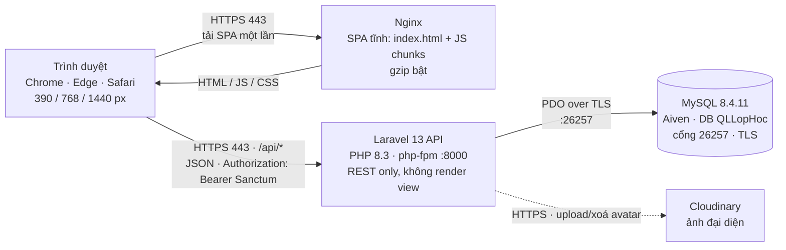
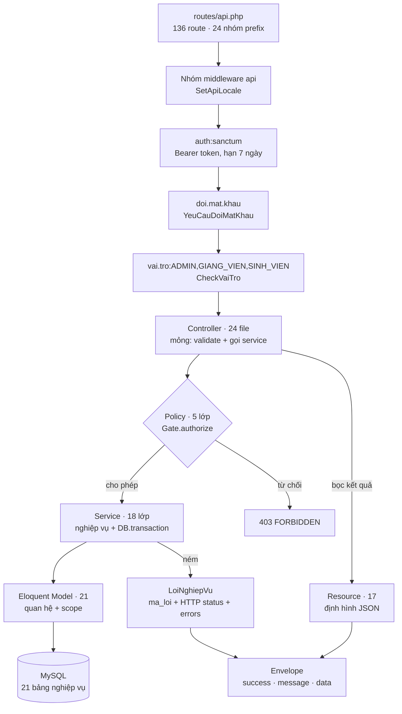
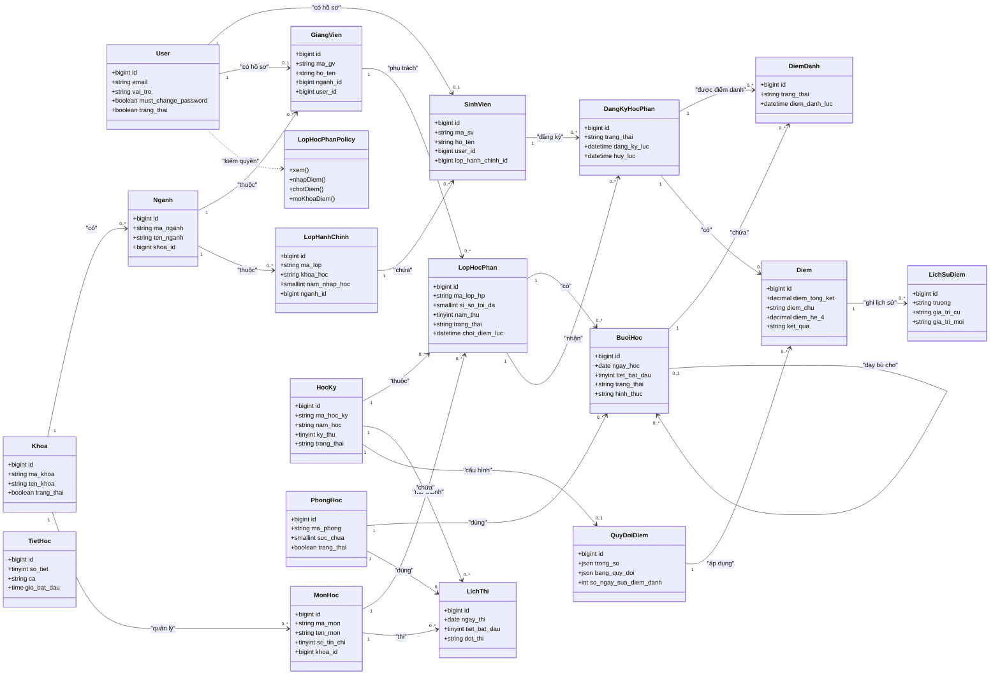
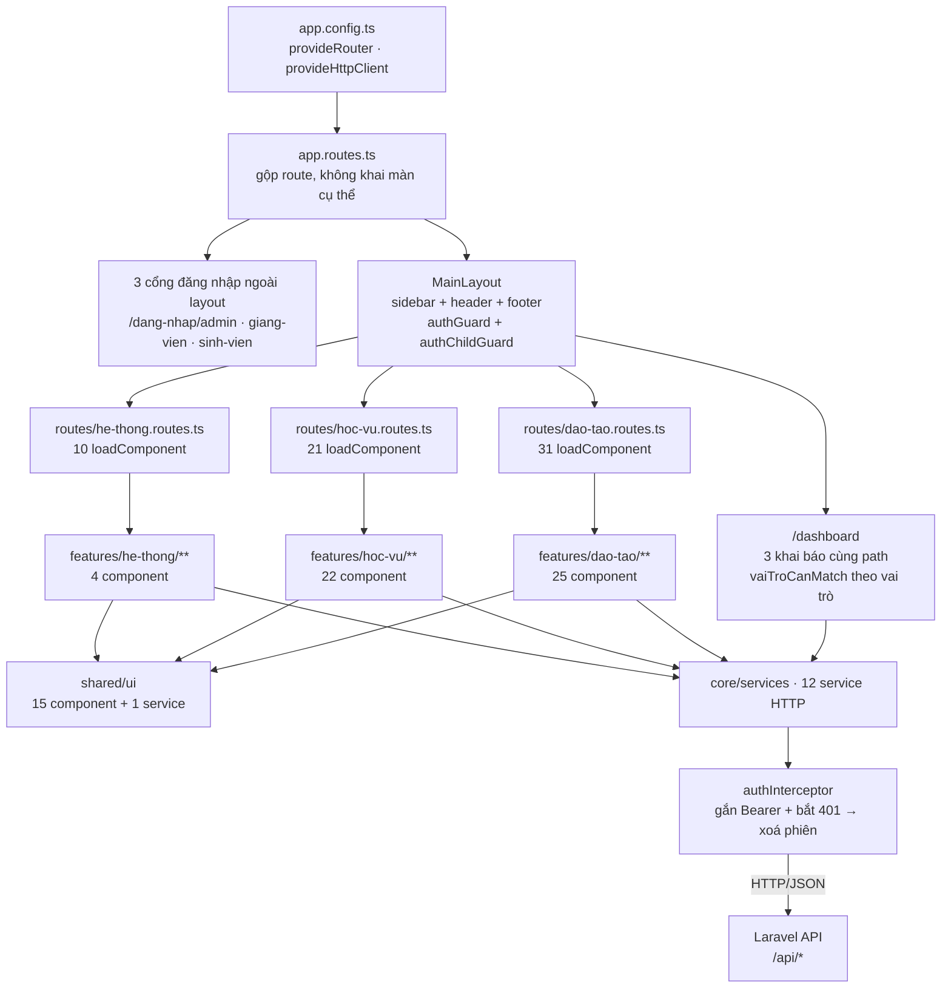
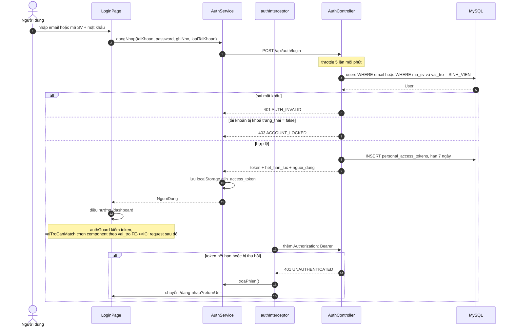
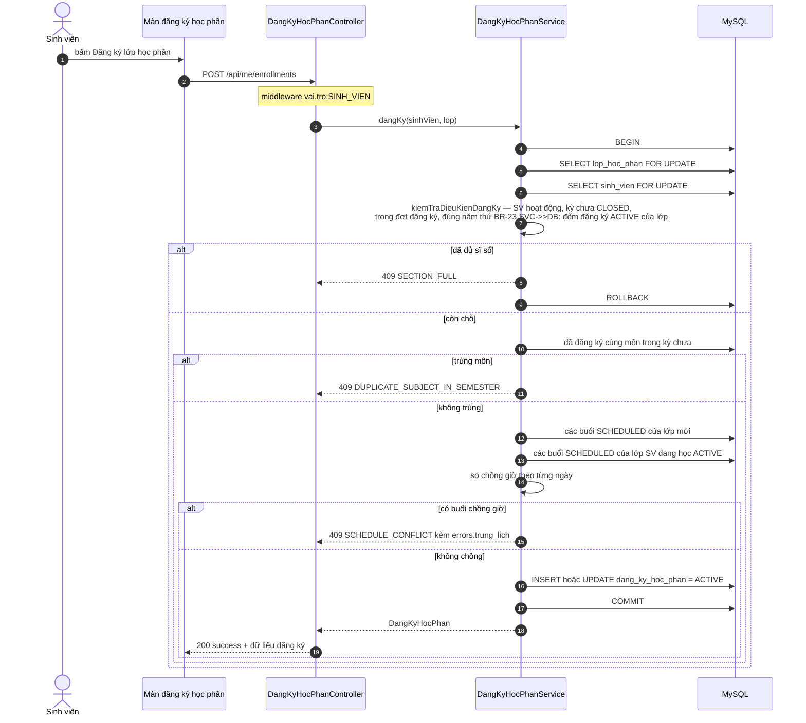
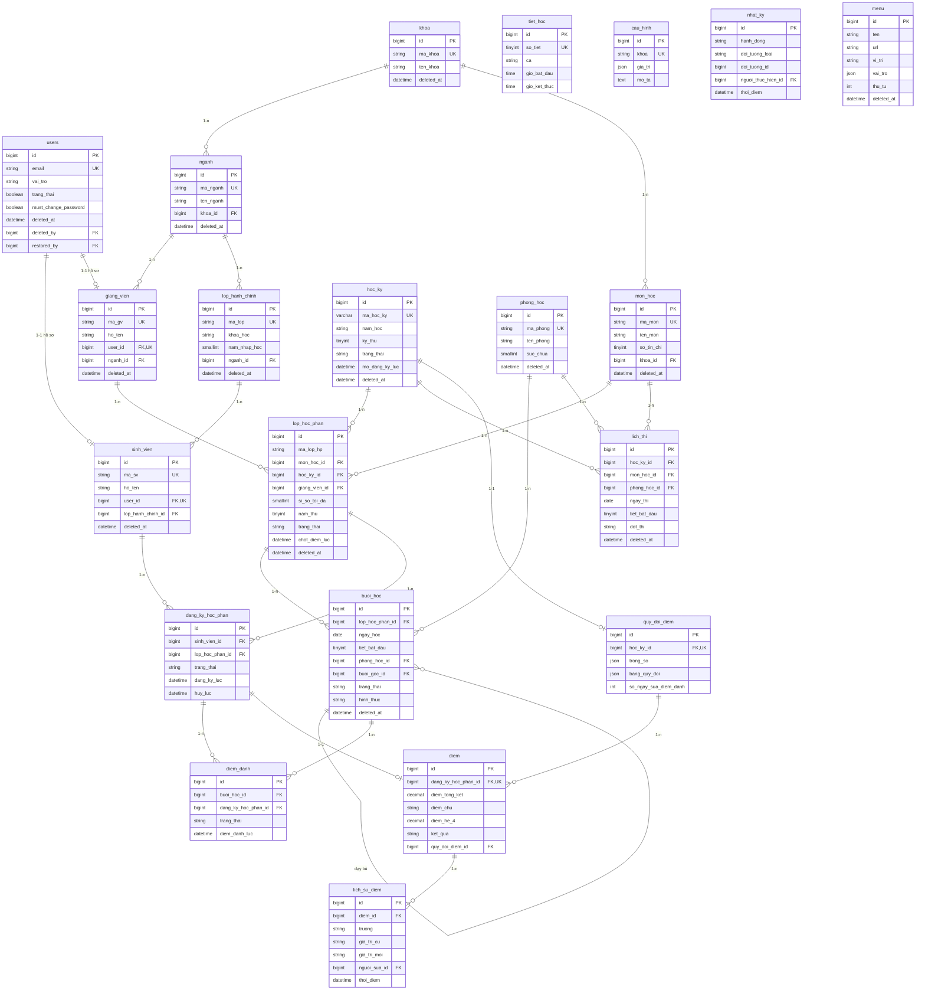

# 09 — Kiến trúc hệ thống QLLH

**Phiên bản:** 1.0 · **Ngày đo:** 2026-11-09 · **Nhánh:** `feature/dashboard-ba-vai-tro`
**Phạm vi:** kiến trúc triển khai thực tế (đọc từ code + DB thật), không phải kiến trúc đề xuất.
Mọi số liệu dưới đây **đo được**; cách đo ghi ở §10. Bản trực quan: [`09-kien-truc-he-thong.html`](09-kien-truc-he-thong.html).

---

## 1. Tóm tắt một trang

**QLLH** là hệ thống quản lý lớp học một trường: quản trị danh mục đào tạo, mở lớp học phần, đăng ký học phần, điểm danh, nhập và chốt điểm, lịch học – lịch thi, cùng ba dashboard theo vai trò.

| Hạng mục | Số đo (2026-11-09) |
|---|---|
| Stack | Laravel 13 · PHP 8.3 · MySQL 8.4.11 (Aiven) · Angular 22 standalone + signals · Material 22 · Tailwind 3 |
| Mã nguồn | **73.691 dòng** = BE 16.126 (app + routes + database) + 7.758 test + FE 49.807 (TS 38.469 · spec 8.815 · HTML 960 · CSS/SCSS 1.563) |
| Endpoint | **136 route** API (GET 58 · POST 30 · PUT 18 · DELETE 17 · PATCH 13) |
| Kiểm thử | PHPUnit **302** (286 pass · **4 fail** · 12 skip) · Vitest **415 / 73 file** (415 pass) |
| Dữ liệu | **21 bảng nghiệp vụ** + 9 bảng hệ thống · 82 index thường · 22 unique · 54 khoá ngoại · 13 bảng xoá mềm |
| Sức khoẻ | **3 việc chặn deploy** · 15 nên sửa · 5 ghi nhận. Pint **fail** 15 file · bundle initial **588,46 kB** vượt budget 500 kB · BE còn 4 test đỏ, FE xanh |

Kết luận một câu: kiến trúc **đã ổn định và nhất quán** (route → middleware → controller mỏng → service → model, envelope thống nhất, phân quyền hai lớp), nhưng **chưa đủ điều kiện deploy** vì bản build production trỏ vào `localhost`, bộ test backend còn đỏ, và dashboard sinh viên vượt ngân sách truy vấn gấp hơn hai lần.

---

## 2. Sơ đồ tổng thể



| Chặng | Giao thức | Cổng | Xác thực |
|---|---|---|---|
| Trình duyệt → Nginx | HTTPS | 443 (staging: 80 trong `nginx.staging.conf`) | Không (tài nguyên tĩnh công khai) |
| Nginx → Laravel | HTTP nội bộ Docker, `proxy_pass http://backend:8000` | 8000 | Không (tin cậy trong mạng compose) |
| Trình duyệt → Laravel | HTTPS `/api/*` | 443 qua proxy | **Bearer token Sanctum**, hạn 7 ngày (`config/sanctum.php:53`), lưu `localStorage` khoá `qllh_access_token` |
| Laravel → MySQL | MySQL protocol qua TLS | 26257 | `avnadmin` + mật khẩu trong `backend/.env` |
| Laravel → Cloudinary | HTTPS | 443 | API key trong `config/cloudinary.php` |

> **Điểm cần biết:** repo chưa nối được chặng "trình duyệt → Laravel" ở môi trường production, vì bản build đang nhúng `http://localhost:8000/api` (xem phát hiện **P1**). Sơ đồ trên là kiến trúc **đúng thiết kế**; bản build hiện tại chưa đạt.

---

## 3. Kiến trúc backend

### 3.1. Luồng xử lý một request



**Bốn điểm kiến trúc đáng chú ý:**

1. **Phân quyền hai lớp.** `vai.tro` chặn theo *vai trò* ở route (thô); Policy chặn theo *đối tượng* ở controller (mịn — ví dụ giảng viên chỉ sửa lớp mình dạy). `Gate::before` cho `ADMIN` bỏ qua mọi Policy đúng FR-01.04.
2. **Envelope thống nhất.** Mọi lỗi được chuẩn hoá ở `bootstrap/app.php:56-160`: `ValidationException` → 422 `VALIDATION_ERROR`, `AuthenticationException` → 401, `AuthorizationException` → 403, `ModelNotFoundException` → 404, `TooManyRequestsHttpException` → 429. `LoiNghiepVu` tự render lỗi nghiệp vụ có `ma_loi` (mặc định 409).
3. **Controller mỏng thật.** Tổng 2.618 dòng cho 24 controller (trung bình 109 dòng); khối lớn nhất `OptionController` 224 dòng là truy vấn dropdown, không chứa nghiệp vụ.
4. **Transaction ở service, không ở controller** — ngoại lệ: `HocKyController:96`, `HoSoController:38`, `MenuController:70` tự mở transaction (xem ghi nhận **G5**).

### 3.2. Sơ đồ lớp theo miền



**Ghi chú đọc sơ đồ**

- Bản số lấy từ quan hệ thật trong `backend/app/Models/*.php` (`hasOne`, `hasMany`, `belongsTo`), không suy đoán.
- `buoi_hoc.buoi_goc_id` là quan hệ **tự thân**: một buổi dạy bù trỏ về buổi gốc đã huỷ.
- `tiet_hoc` **không có khoá ngoại** — đó là khung tiết cấu hình dùng chung, buổi học và ca thi lưu bản sao `tiet_bat_dau/tiet_ket_thuc` + `gio_bat_dau/gio_ket_thuc`.
- `dang_ky_hoc_phan` là bảng nối n-n giữa `sinh_vien` và `lop_hoc_phan`, nhưng **mang trạng thái** (`ACTIVE`/`CANCELLED`) nên là thực thể đầy đủ chứ không phải bảng nối thuần.
- `quy_doi_diem` là 0..1 theo học kỳ (`hoc_ky_id` unique).

### 3.3. 18 Service và việc mỗi service làm

| # | Service | Việc |
|---|---|---|
| 1 | `CloudinaryService` | Upload / xoá ảnh đại diện lên Cloudinary; DB chỉ giữ `avatar_url` + `avatar_public_id` (ADR-019) |
| 2 | `DangKyHocPhanService` | Đăng ký, huỷ, đăng ký hàng loạt; kiểm sĩ số, trùng môn trong kỳ, trùng lịch, năm thứ (BR-23/BR-27), khoá dòng bằng `lockForUpdate` |
| 3 | `DashboardService` | Số liệu 3 dashboard: ADMIN (4 thẻ, tỷ lệ lấp đầy 4 kỳ, lớp sắp mở, đăng ký gần đây), GIANG_VIEN và SINH_VIEN theo học kỳ chọn |
| 4 | `QuanLyBuoiHocService` | Sinh lịch hàng tuần, thêm/sửa/huỷ/mở lại/xoá buổi học; gọi `ScheduleService` trong cùng transaction, khoá phòng |
| 5 | `QuanLyCauHinhService` | Đọc/ghi `cau_hinh` (trọng số điểm, bảng quy đổi), danh sách học kỳ áp dụng |
| 6 | `QuanLyDiemDanhService` | Danh sách điểm danh theo buổi, lưu hàng loạt, điểm danh của tôi, thống kê chuyên cần |
| 7 | `QuanLyDiemService` | Nhập điểm đơn, lịch sử sửa điểm, điểm của tôi, GPA/CPA, tính điểm tổng kết + điểm chữ + hệ 4 |
| 8 | `QuanLyHoSoService` | CRUD hồ sơ sinh viên / giảng viên / lớp hành chính; khoá–kích hoạt đơn lẻ và hàng loạt; xoá hàng loạt |
| 9 | `QuanLyHocKyService` | Tạo, sửa, xoá, chuyển trạng thái học kỳ; vòng đời chỉ tiến, một kỳ ONGOING (ADR-017) |
| 10 | `QuanLyKhoaNganhService` | CRUD khoa / ngành; chặn xoá khi còn bản ghi con (ADR-020) |
| 11 | `QuanLyLichThiService` | CRUD ca thi; xung đột chỉ xét phòng thi, dùng chung khung tiết |
| 12 | `QuanLyLopHocPhanService` | CRUD lớp học phần, bảng điểm, nhập điểm hàng loạt, chốt/mở khoá điểm, thống kê chuyên cần |
| 13 | `QuanLyMonHocService` | Xoá, khoá/mở hàng loạt môn học |
| 14 | `QuanLyNguoiDungService` | CRUD tài khoản, khoá (thu hồi toàn bộ token — BR-30), đặt lại mật khẩu, đổi trạng thái hàng loạt |
| 15 | `QuanLyNhatKyService` | Danh sách / chi tiết nhật ký, danh mục lọc cho dropdown |
| 16 | `QuanLyPhongHocService` | Xoá, khoá/mở hàng loạt phòng học |
| 17 | `ScheduleService` | Lõi phát hiện trùng lịch dùng chung: phòng, giảng viên, sinh viên, và ca thi; **chỉ đọc** |
| 18 | `ThungRacService` | Liệt kê và khôi phục bản ghi xoá mềm theo loại thực thể (map type → model) |

---

## 4. Kiến trúc frontend

### 4.1. Luồng điều hướng và nạp mã



| Cơ chế | File | Vì sao quan trọng |
|---|---|---|
| Lazy `loadComponent` | 74 khai báo: 62 ở `routes/*.routes.ts` (đào tạo 31 · học vụ 21 · hệ thống 10) + 12 ở `app.routes.ts` | Toàn bộ màn nghiệp vụ nằm ngoài bundle initial; initial chỉ 588 kB dù có 85 component |
| `roleGuard` (canActivate) | `core/auth/auth.guard.ts` | Chặn theo `data.roles`; cũng chặn khi `must_change_password` |
| `vaiTroCanMatch` (canMatch) | `core/auth/vai-tro-can-match.guard.ts` | Chọn component **trước khi** router chốt route — cần cho `/dashboard` ba vai trò dùng chung một path |
| `authInterceptor` | `core/auth/auth.interceptor.ts` | Gắn `Authorization` cho mọi request bắt đầu bằng `apiBaseUrl`; 401 → `xoaPhien()` + chuyển `/dang-nhap?returnUrl=` |
| `laTrangChuaLamGuard` | `core/auth/trang-chua-lam.guard.ts` | URL có trong menu nhưng chưa có màn → trang "chưa làm" **trong** layout, không rơi 404 |

### 4.2. Thư mục `frontend/src/app/` (số file đo thật)

| Thư mục | Vai trò | Số file |
|---|---|---|
| `core/auth/` | `auth.service`, guard (`authGuard`, `roleGuard`, `guestGuard`, `vaiTroCanMatch`), interceptor | 8 |
| `core/services/` | HTTP client theo resource (12 service + 6 spec) | 18 |
| `core/models/` | Kiểu dữ liệu khớp hợp đồng API | 3 |
| `core/layout/` | `main-layout`, `sidebar`, `header`, `footer` | 6 |
| `core/mock/` + `mock/registry/` + `mock/data/` | Mock backend cho lúc BE chưa có (đang tắt: `useMock: false`) | 22 |
| `core/utils/` | `menu-vai-tro`, `menu-url`, `chuan-hoa-tim-kiem` + spec | 7 |
| `shared/ui/` | Component dùng chung (xem §4.3) | 18 |
| `shared/pipes/` | `ngayVn` — định dạng dd/mm/yyyy | 1 |
| `routes/` | 3 nhóm route + 3 file menu + 3 spec | 8 |
| `features/dao-tao/` | Sinh viên, giảng viên, lớp hành chính, môn, học kỳ, phòng, khoa, ngành | 48 |
| `features/hoc-vu/` | Lớp học phần, đăng ký, lịch học, lịch thi, điểm danh, điểm, menu | 31 |
| `features/dashboard/` | 7 component (3 dashboard + 4 biểu đồ/thẻ) + model + hàm tính toán + spec | 20 |
| `features/he-thong/` | Cấu hình, người dùng, nhật ký | 7 |
| `features/auth/`, `tai-khoan/`, `thung-rac/`, `not-found/`, `style-guide/` | Đăng nhập, hồ sơ, thùng rác, 404, trang mẫu token | 13 |
| Gốc `app/` | `app.ts`, `app.config.ts`, `app.routes.ts` + spec | 7 |

### 4.3. `shared/ui/` — 18 file, nhưng **15 component**

| Loại | Danh sách |
|---|---|
| Component (15) | `app-alert` · `app-button` · `app-card` · `chon-tim-kiem` · `confirm-dialog` · `dang-xay-dung` · `data-table` · `date-input` · `empty-state` · `form-field` · `loading` · `page-header` · `pagination` · `search-input` · `status-badge` |
| Service (1) | `app-toast` (`app-toast.service.ts`) |
| Spec (2) | `design-system.spec.ts` · `shared-components.spec.ts` |

> **Lưu ý đếm:** thư mục có 18 **file**, gồm 15 component + 1 service + 2 file test. Khi cần đếm component dùng chung, con số đúng là **15**.

---

## 5. Luồng nghiệp vụ then chốt

### 5.1. Đăng nhập và phân quyền



**Ba lớp bảo vệ, không lớp nào thay được lớp khác**

| Lớp | Ở đâu | Bắt được gì | Không bắt được gì |
|---|---|---|---|
| `auth:sanctum` | Route | Không có / sai / hết hạn token | Token hợp lệ nhưng sai vai trò |
| `doi.mat.khau` | Route | `must_change_password = true` gọi endpoint khác 3 route cho phép | Người dùng vai trò khác |
| `vai.tro:x,y` | Route | Vai trò không nằm trong danh sách | Cùng vai trò nhưng không sở hữu đối tượng (GV A sửa lớp GV B) |
| Policy + `Gate::authorize` | Controller | Sở hữu đối tượng cụ thể | — (ADMIN bỏ qua qua `Gate::before`) |

### 5.2. Đăng ký học phần: sĩ số + trùng lịch



**Vì sao thiết kế này chống được ghi đè sĩ số**

| Cơ chế | Tác dụng | Chỗ code |
|---|---|---|
| `DB::transaction` | Toàn bộ kiểm tra + ghi là một đơn vị; lỗi giữa đường không để lại bản ghi dở | `DangKyHocPhanService.php:63` |
| `lockForUpdate()` trên lớp và sinh viên | Hai request đồng thời cho cùng lớp bị tuần tự hoá; người sau thấy số đăng ký đã tăng | `:64-65` |
| Sĩ số **không lưu cột** | Không có cột để lệch; luôn đếm `dang_ky_hoc_phan` trạng thái ACTIVE | `LopHocPhan::siSoHienTai()` |
| Unique `(sinh_vien_id, lop_hoc_phan_id)` | Chốt chặn cuối ở tầng DB nếu logic trên có khe hở | Migration `2026_10_21_001800` |

> **Nợ kỹ thuật đã xác nhận (phát hiện S4):** phần kiểm tra trùng lịch ở luồng này dùng `DangKyHocPhanService::kiemTraTrungLich` (private, `:211-261`) — một bản cài **thứ hai** của cùng luật BR-06/BR-22. `ScheduleService::timTrungLichDangKy` tồn tại nhưng **chỉ test gọi**, không có chỗ dùng thật. Hai bản luật có thể trôi khác nhau.

---

## 6. Sơ đồ dữ liệu

**Đo trên DB thật (`QLLopHoc`, MySQL 8.4.11):** 30 bảng = **21 bảng nghiệp vụ** + 9 bảng hệ thống (`cache`, `cache_locks`, `failed_jobs`, `job_batches`, `jobs`, `migrations`, `password_reset_tokens`, `personal_access_tokens`, `sessions`).

> Tài liệu cũ ghi 23 bảng. Con số đúng là **21 bảng nghiệp vụ**; nếu tính thêm `personal_access_tokens` và `sessions` thì thành 23 — nhưng hai bảng đó thuộc hạ tầng framework, không phải mô hình nghiệp vụ. Sơ đồ dưới chỉ vẽ bảng nghiệp vụ.



### 6.1. Ràng buộc cần nhớ

| Loại | Số lượng | Ghi chú |
|---|---|---|
| Khoá ngoại (DB thật) | **54** | 24 khoá **nghiệp vụ** (vẽ ở sơ đồ trên) + 30 khoá **kiểm toán** trỏ `users.id`: `deleted_by`, `restored_by`, `dang_ky_boi`, `huy_boi`, `diem_danh_boi`, `chot_diem_boi`, `nguoi_sua_id`, `nguoi_thuc_hien_id` |
| Unique (ngoài PK) | **22** | Gồm 5 unique **ghép**: `lop_hoc_phan(hoc_ky_id, ma_lop_hp)`, `dang_ky_hoc_phan(sinh_vien_id, lop_hoc_phan_id)`, `diem_danh(buoi_hoc_id, dang_ky_hoc_phan_id)`, `hoc_ky(nam_hoc, ky_thu)`, `nganh(khoa_id, ten_nganh)` |
| Index thường | **82** | Nhiều index sinh tự động từ khoá ngoại; index ghép đáng chú ý: `buoi_hoc(lop_hoc_phan_id, ngay_hoc)`, `buoi_hoc(phong_hoc_id, ngay_hoc)`, `dang_ky_hoc_phan(lop_hoc_phan_id, trang_thai)`, `dang_ky_hoc_phan(sinh_vien_id, trang_thai)`, `lich_su_diem(diem_id, thoi_diem)`, `lich_thi(hoc_ky_id, ngay_thi)` |
| Bảng xoá mềm | **13** | `users`, `sinh_vien`, `giang_vien`, `khoa`, `nganh`, `lop_hanh_chinh`, `mon_hoc`, `hoc_ky`, `phong_hoc`, `lop_hoc_phan`, `buoi_hoc`, `menu`, `lich_thi` |
| Không xoá mềm | 8 | `dang_ky_hoc_phan` (dùng `CANCELLED`), `diem_danh`, `diem`, `lich_su_diem`, `nhat_ky`, `cau_hinh`, `quy_doi_diem`, `tiet_hoc` |

Unique index **không** bao gồm `deleted_at` → bản ghi đã xoá mềm vẫn chiếm mã (BR-01). Đây là quyết định có chủ đích, không phải thiếu sót.

### 6.2. Dữ liệu đang có (đo trên DB Aiven ngày 2026-11-09)

| Bảng | Số dòng | Bảng | Số dòng |
|---|---:|---|---:|
| `users` | 555 | `sinh_vien` | 501 |
| `giang_vien` | 51 | `lop_hanh_chinh` | 20 |
| `nganh` | 5 | `khoa` | 1 |
| `mon_hoc` | 30 | `hoc_ky` | 3 |
| `phong_hoc` | 25 | `tiet_hoc` | 15 |
| `lop_hoc_phan` | 120 | `buoi_hoc` | 2.040 |
| `dang_ky_hoc_phan` | 7.028 | `diem_danh` | 86.443 |
| `diem` | 2.999 | `quy_doi_diem` | 1 |
| `menu` | 23 | `cau_hinh` | 3 |
| `nhat_ky` | 5 | `lich_thi` | **0** |
| `lich_su_diem` | **0** | | |

`diem_danh` 86.443 dòng là bảng lớn nhất — mọi tối ưu đọc điểm danh phải bắt đầu từ đây.

---

## 7. Chỉ số sức khoẻ

### 7.1. Backend

| Chỉ số | Số đo | Cách đo | Đánh giá |
|---|---:|---|---|
| Route API | 136 | `php artisan route:list --path=api --json` | GET 58 · POST 30 · PUT 18 · DELETE 17 · PATCH 13 |
| Controller | 24 | `ls app/Http/Controllers/Api/` | Trung bình 109 dòng/controller |
| Service | 18 | `ls app/Services/` | |
| Model | 21 | `ls app/Models/` | |
| Resource | 17 | `ls app/Http/Resources/` | |
| FormRequest | 26 | `find app/Http/Requests -name '*.php'` | |
| Policy | 5 | `ls app/Policies/` | LichThiPolicy tự phát hiện, không cần đăng ký |
| Middleware | 4 | `ls app/Http/Middleware/` | 3 alias + `SetApiLocale` |
| Migration | 36 | `ls database/migrations/` | |
| PHPUnit | **302 test**: 286 pass · **4 fail** · 12 skip | `php artisan test` | 1.725 assert · 13,5 s · SQLite memory |
| Pint | **fail** 15 file | `vendor/bin/pint --test` | Lỗi style, không lỗi logic |

12 test **skip** là các test cần MySQL/Docker thật (`MySQLThucTeTest`); chạy được bằng `composer test:mysql`.

### 7.2. Frontend

| Chỉ số | Số đo | Cách đo | Đánh giá |
|---|---:|---|---|
| Component standalone | **85** | `grep -rl "@Component"` trừ spec | 100% `standalone: true` |
| `ChangeDetectionStrategy.OnPush` | **4 / 85** (4,7%) | `grep -rl` | Chỉ 4 component dashboard mới (`the-so-lieu`, `bieu-do-tron`, `bieu-do-cot-diem`, `chon-hoc-ky`) |
| `@defer` | **0** | `grep -rn "@defer" --include="*.html"` | Không có block trì hoãn nào |
| File dùng `signal()` | 64 | `grep -rl "signal("` trừ spec | Signals đã dùng rộng, nhưng chưa kèm OnPush nên lợi ích bị chặn |
| Bundle initial | **588,46 kB** (146,74 kB transfer) | `npx ng build --configuration production` | **Vượt budget cảnh báo 500 kB đúng 88,45 kB** |
| Chunk lớn nhất | `main` 343,79 kB + `chunk` 167,42 kB | cùng lệnh trên | |
| Vitest | **415 test / 73 file**: 415 pass · 0 fail | `npx ng test --watch=false` | Đo lại 10:20 — suite đã xanh |
| File TS app | 211 (74 spec) | `find` | |
| Service HTTP | 12 | `ls core/services` | `lop-hoc-phan` nhiều nhất: 15 lời gọi |
| Route lazy | 74 khai báo `loadComponent` | `grep` trong `app.routes.ts` + `routes/*.routes.ts` | |

Basic auth: không dùng. Xác thực 100% Bearer token.

### 7.3. Cơ sở dữ liệu

| Chỉ số | Số đo | Đánh giá |
|---|---:|---|
| Bảng nghiệp vụ | 21 | + 9 bảng hệ thống = 30 |
| Engine | InnoDB 30/30 | `information_schema.TABLES` |
| Phiên bản | MySQL **8.4.11** | `SELECT VERSION()` |
| Index thường (ngoài PK) | 82 | Nhiều index sinh từ FK |
| Unique (ngoài PK) | 22 | 5 unique ghép |
| Khoá ngoại | 54 | 24 nghiệp vụ + 30 kiểm toán |
| Bảng xoá mềm | 13 | |
| Index đề xuất chưa tạo | 3 | `docs/03-data-model.md` §5.7 — cho dashboard TEACHER/STUDENT |

### 7.4. Tài liệu

| Chỉ số | Số đo | Ghi chú |
|---|---:|---|
| Dòng Markdown trong `docs/` | 6.319 | Không tính file 09 này (tự nó 872 dòng) |
| `openapi.yaml` | 68 path | Máy đọc |
| Postman | 74 request | Chưa cập nhật sau đợt lịch học/lịch thi |
| ADR | 22 | `docs/07-decisions.md` (ADR-001 → ADR-022) |

---

## 8. Phát hiện kiến trúc

Ba mức: **P** = chặn deploy (không được lên staging/production khi còn), **S** = nên sửa trước đợt sau, **G** = ghi nhận, không cấp bách.

### 8.1. Chặn deploy (3)

| Mã | Vị trí | Vấn đề | Đề xuất |
|---|---|---|---|
| **P1** | `frontend/angular.json:35-56` · `frontend/src/environments/environment.prod.ts:3` | `angular.json` **không khai `fileReplacements`**, nên `ng build --configuration production` vẫn biên dịch `environment.ts`. Bundle production đo được chứa `apiBaseUrl: http://localhost:8000/api` (chuỗi nằm trong `dist/frontend/browser/chunk-DLMK2nu8.js`). Deploy lên staging là **mọi lời gọi API trắng**, trong khi `environment.prod.ts` khai đúng `/api` là file chết. | Thêm `fileReplacements` cho configuration `production`: thay `src/environments/environment.ts` bằng `environment.prod.ts`. Đồng thời đặt `useMock: false` ở file prod. Kiểm lại bằng `grep localhost dist/**/*.js` phải ra 0. |
| **P2** | `backend/tests/Feature/DashboardVaiTroTest.php:233, 422, 578, 882` | **Bộ test backend chưa xanh**: PHPUnit 302 test còn **4 fail**, cả bốn đều thuộc dashboard ba vai trò — chọn kỳ mặc định, hạn sửa điểm danh, kiểu số `1` vs `1.0`, và ngân sách truy vấn. Phía frontend đã xanh trong lúc rà soát (415/415 lúc 10:23); trước đó có 1 fail ở `dashboard-sinh-vien.spec.ts:265`. Theo "định nghĩa xong" của dự án, không đợt nào hoàn tất khi test đỏ. | Sửa 4 test hoặc sửa code cho khớp; không nới assert để test xanh giả. Riêng test ngân sách truy vấn (P3) phải sửa **code**, không nới ngưỡng. |
| **P3** | `backend/app/Services/DashboardService.php:395-524` · gọi `QuanLyDiemService::gpaCuaToi` | **Dashboard sinh viên dùng 18 truy vấn, ngân sách 8** (test `test_dashboard_student_toi_da_8_truy_van` fail: *"Dashboard student dùng 18 truy vấn, vượt ngân sách 8"*). Nguyên nhân: `layThongKeSinhVien` gọi `gpaCuaToi()` mà hàm này gọi lại `diemCuaToi()`, cộng thêm chuỗi truy vấn chọn học kỳ, đăng ký, điểm danh, thời khoá biểu. Vượt gấp 2,25 lần ngưỡng UC-16 AC-3 (< 500 ms). | Gộp: (a) truyền `$hocKy` đã chọn xuống `gpaCuaToi` để không chọn kỳ hai lần; (b) tính CPA bằng **một** truy vấn join `dang_ky_hoc_phan → lop_hoc_phan → diem` thay vì tải cả collection rồi gộp trong PHP; (c) tái dùng `$dangKys` đã tải cho phần chuyên cần. Mục tiêu: ≤ 8. |

### 8.2. Nên sửa (15)

| Mã | Vị trí | Vấn đề | Đề xuất |
|---|---|---|---|
| **S1** | `backend/routes/api.php:80-88` và `:115-124` | **6 route `/api/semesters` khai hai lần**. Laravel gộp theo method+uri nên tổng route vẫn 136, nhưng middleware **cộng dồn**: `POST /api/semesters` chạy `CheckVaiTro` **hai lần** với hai danh sách khác nhau (`route:list -v` hiện 5 middleware). Đọc route rất dễ hiểu sai. | Xoá block `:115-124`, giữ block `:80-88` (đã khai `name()`). Kiểm: `route:list -v` mỗi route semesters chỉ còn 1 `CheckVaiTro`. |
| **S2** | `backend/routes/api.php:279-281` và `:106` | Hai route **thừa, không theo hợp đồng**: `GET /api/user` trả `User` trần **không bọc envelope** (route debug mẫu của Laravel); `GET /api/audit-logs` là alias của `GET /api/logs`, cùng `NhatKyController@index`. | Xoá `/api/user`. Giữ một trong `/logs` và `/audit-logs` (đề xuất giữ `/logs` vì FE đang gọi đường đó). |
| **S3** | `backend/app/Services/DangKyHocPhanService.php:211-261` so với `ScheduleService.php:211-234` | **Hai bản cài cùng một luật** chống trùng lịch. Bản trong `DangKyHocPhanService` là bản chạy thật; `ScheduleService::timTrungLichDangKy` **chỉ có test gọi** (không nơi nào trong `app/` dùng). Sửa một bên là bên kia trôi. | Cho `DangKyHocPhanService` gọi `ScheduleService::timTrungLichDangKy`, xoá `kiemTraTrungLich` private. Hoặc ngược lại — nhưng chỉ giữ **một** bản. |
| **S4** | `backend/app/Services/QuanLyDiemDanhService.php:307-310` | **N+1**: trong `foreach ($dangKys)` truy vấn `DiemDanh` riêng cho từng đăng ký. Sinh viên 8 học phần → 8 truy vấn điểm danh, mỗi truy vấn quét bảng 86.443 dòng. | Thay bằng **một** truy vấn gộp `whereIn('dang_ky_hoc_phan_id', $ids)` rồi nhóm trong PHP — đúng cách `DashboardService::thongKeChuyenCanTheoDangKy` đã làm. |
| **S5** | `backend/` toàn bộ | `vendor/bin/pint --test` **fail 15 file**: `DashboardService`, `QuanLyDiemService`, `QuanLyCauHinhService`, `HocKyController`, `OptionController`, `ThungRacController`, `ThungRacService`, `CauHinhController`, `DiemController`, `DashboardController`, `NhapDiemDonRequest`, migration `2026_10_30_000200`, `DashboardTest`, `DashboardVaiTroTest`, `ThungRacTest`. | Chạy `vendor/bin/pint` (chỉ định dạng, không đổi hành vi) rồi commit cùng đợt. Không trộn vào commit tính năng. |
| **S6** | `frontend/angular.json:36-41` | Bundle initial **588,46 kB vượt budget cảnh báo 500 kB 88,45 kB**; ngưỡng lỗi 1 MB nên build vẫn xanh và cảnh báo dễ bị bỏ qua. | Không nâng budget. Cắt thật: `@defer` cho biểu đồ dashboard, tách `Material` chỉ import module cần, kiểm `main` 343,79 kB xem có gì kéo vào sớm. Đo lại bằng `ng build`. |
| **S7** | Toàn bộ `frontend/src/app/` | **OnPush 4/85 component**, **`@defer` 0**. 81 component còn lại chạy change detection mặc định, quét lại cây mỗi sự kiện — chi phí này hiện chưa lộ vì màn nhỏ, nhưng là rào cản chính của mục tiêu Lighthouse ≥ 90. | Bật OnPush cho toàn bộ component mới; chuyển dần 85 component. Điều kiện tiên quyết: đã dùng signals (64 file) nên chuyển được mà không phải viết lại. |
| **S8** | `frontend/src/index.html:15,18` | **Hai stylesheet Google Fonts chặn render**: 4 độ đậm × 2 họ chữ + `Material Icons` (font icon cả bộ, dù chỉ dùng vài chục glyph). Không self-host, không `preload` font file. | Self-host font (tải woff2 vào `public/fonts`), `font-display: swap`; thay Material Icons bằng SVG icon hoặc subset. Đo lại LCP. |
| **S9** | `frontend/src/environments/environment.prod.ts:4` | File production đặt `useMock: true`. Hiện vô hại vì file này **chưa được dùng** (P1), nhưng sửa P1 xong là bật mock interceptor ở production → API thật không bao giờ được gọi. | Đặt `useMock: false` trong cùng lượt sửa P1. |
| **S10** | `backend/dt.json` · `backend/tests/Feature/TmpDebugTest.php` · `frontend/src/app/features/dashboard/dbg4.spec.ts` | **Rác debug chưa commit** nằm trong cây làm việc và **không có trong `.gitignore`**. `TmpDebugTest` chạy cùng suite; `dbg4.spec.ts` có test `"ai xoa queue"` in vết. | Xoá cả ba. Nếu cần giữ mẫu đo, đặt dưới `tools/` và thêm vào `.gitignore`. |
| **S11** | `backend/bootstrap/app.php:37` · `app/Http/Middleware/CheckTaiKhoanHoatDong.php` | Middleware `CheckTaiKhoanHoatDong` được đăng ký alias `tai.khoan.hoat.dong` nhưng **không route nào dùng** → code chết. Hệ quả: việc khoá tài khoản chỉ dựa vào thu hồi token ở `QuanLyNguoiDungService`; nếu có đường nào đổi `users.trang_thai` mà quên thu hồi, token cũ vẫn sống tới 7 ngày. | Gắn `tai.khoan.hoat.dong` vào nhóm middleware chung (sau `auth:sanctum`) để mọi request kiểm `trang_thai` — rẻ, một truy vấn đã có sẵn từ `auth`. Hoặc xoá middleware và ghi rõ BR-30 chỉ xử lý ở service. |
| **S12** | `docs/03-data-model.md` | **Tài liệu trôi khỏi DB**: thiếu hẳn bảng `tiet_hoc` và `lich_thi`; bảng `buoi_hoc` (§3.9) thiếu cột `tiet_bat_dau`, `tiet_ket_thuc`, `hinh_thuc`, `buoi_goc_id`; danh sách xoá mềm (§4) ghi 10 bảng trong khi DB có **13** (thiếu `khoa`, `nganh`, `lich_thi`); §6 thứ tự migration dừng ở `2026_10_30_000200` — thiếu **7** file về sau (`2026_11_04`→`2026_11_08`). | Bổ sung §3.20 `tiet_hoc`, §3.21 `lich_thi`, cập nhật §3.9, §4, §6. Việc này thuộc `qllh-analyst`, không phải backend. |
| **S13** | `docs/04-api-contract.md:1630` | Bảng §18 ghi `dashboard` "Đặc tả 3 · Đã code **1**" và tổng "code **134**". Đo lại: dashboard đã code **3** route, tổng **136**. Tài liệu đang tự báo thiếu hai endpoint đã có. | Cập nhật cột "Đã code" của `dashboard` thành 3, tổng thành 136, và ghi lại ngày đo 2026-11-09. |
| **S14** | `docs/03-data-model.md:482,515` | **Trùng số mục**: `### 3.15` xuất hiện hai lần (`cau_hinh` và `nhat_ky`). Mọi tham chiếu "§3.15" đều nhập nhằng. | Đánh số lại `nhat_ky` thành 3.16 và dồn các mục sau; hoặc dùng 3.15a/3.15b nếu muốn giữ số cũ trong tham chiếu. |
| **S15** | `docker-compose.staging.yml:60` | **`APP_KEY` hardcode giá trị mặc định trong repo**: `APP_KEY: ${APP_KEY:-base64:QUhk...}`. Ai đọc repo cũng có khoá mã hoá của staging; biến không được đặt thì hệ thống vẫn chạy với khoá công khai. | Đổi thành `${APP_KEY:?APP_KEY bắt buộc}` để compose **từ chối chạy** khi thiếu; phát khoá mới qua secret/`.env` không commit. |

### 8.3. Ghi nhận (5)

| Mã | Vị trí | Ghi nhận | Hướng xử lý |
|---|---|---|---|
| **G1** | `frontend/src/app/core/auth/auth.service.ts:42` | Token Sanctum (hạn 7 ngày, không cơ chế refresh) lưu trong `localStorage`. XSS là mất phiên 7 ngày. Đổi mật khẩu có thu hồi token khác; khoá tài khoản cũng thu hồi (BR-30) — nên rủi ro đã được giảm ở phía server. | Chấp nhận cho đồ án. Nếu siết: chuyển sang cookie `httpOnly` + `SameSite`, bật `supports_credentials` và `SANCTUM_STATEFUL_DOMAINS`. Đây là đổi hợp đồng auth → **chờ user chốt**. |
| **G2** | `backend/app/Providers/AppServiceProvider.php:37` | `Gate::before` cho `ADMIN` bỏ qua **mọi** Policy. Đúng FR-01.04, nhưng nghĩa là Policy chỉ bảo vệ `GIANG_VIEN`/`SINH_VIEN`. Thêm vai trò mới (ví dụ `TRUONG_KHOA`) sẽ mặc định **không** bị Policy chặn nếu quên sửa `Gate::before`. | Giữ nguyên. Ghi thành luật trong ADR: mọi vai trò mới phải rà lại `Gate::before` và bảng phân quyền `docs/01`. |
| **G3** | 47/85 component không có `.spec.ts`; 28 file test PHPUnit (25 Feature + 1 Unit + 2 file hỗ trợ) cho 24 controller | Độ phủ test **không đều**: tầng service/route có test dày (302 test), tầng component nhiều màn chưa có test riêng (`features/hoc-vu/diem-danh/*`, `lop-hoc-phan/danh-sach`, toàn bộ `shared/ui` trừ hai file gộp). | Trước deploy không cần phủ hết. Ưu tiên viết test cho 3 màn có ghi dữ liệu: điểm danh, nhập điểm, đăng ký. |
| **G4** | `backend/app/Notifications/` **không tồn tại** | Phần **thông báo** (mục tiêu còn lại của dự án: DB + polling) chưa bắt đầu ở backend: chưa có model, migration `notifications`, controller, endpoint `GET /api/notifications/unread-count`. | Đây là phạm vi mới, không phải nợ kỹ thuật. Hướng đã chốt trong `CLAUDE.md`: Laravel Notification, `via()` chỉ `['database']`, FE polling 30 s dừng khi tab ẩn. |
| **G5** | `HocKyController.php:96` · `HoSoController.php:38` · `MenuController.php:70` | Ba controller **tự mở `DB::transaction`** và ghi dữ liệu, lệch quy ước "controller mỏng, nghiệp vụ ở service" mà 18 service còn lại đang theo. Không phải lỗi chức năng, nhưng làm mờ ranh giới tầng. | Khi chạm ba module này, chuyển logic vào service tương ứng. Không refactor riêng lẻ vì không có số đo lỗi. |

---

## 9. Đề xuất ưu tiên — 5 việc làm trước

> Phụ lục tái lập mọi số liệu: §10 *Cách đo lại*.

| Thứ tự | Việc | Lý do một dòng |
|---|---|---|
| **1** | Sửa `fileReplacements` production + đặt `useMock: false` (P1, S9) | Bản build hiện tại trỏ `localhost:8000` — deploy là hệ thống chết, mọi việc khác vô nghĩa. Sửa mất khoảng 5 dòng. |
| **2** | Sửa 4 test backend đỏ, trong đó **giảm dashboard sinh viên 18 → ≤ 8 truy vấn** bằng code chứ không nới ngưỡng (P2, P3) | Test đỏ chặn "định nghĩa xong"; 18 truy vấn trên bảng `diem_danh` 86k dòng là rủi ro hiệu năng thật khi có nhiều sinh viên vào cùng lúc. |
| **3** | Xoá 6 route `semesters` trùng + 2 route thừa (`/user`, `/audit-logs`) (S1, S2) | Giảm bề mặt tấn công và làm `route:list` đọc được; hiện một route chạy middleware hai lần, dễ hiểu sai khi phân quyền. |
| **4** | Hợp nhất luật chống trùng lịch về một chỗ, sửa N+1 điểm danh (S3, S4) | Hai bản cài cùng luật BR-06/BR-22 sẽ trôi khác nhau; N+1 điểm danh là truy vấn nặng nhất hệ thống. |
| **5** | Chạy `pint` + cập nhật `docs/03` (bảng `tiet_hoc`/`lich_thi`, 13 bảng xoá mềm, §6) và `docs/04` §18 (136 route) (S5, S12, S13, S14) | Cổng chất lượng phải xanh trước khi bàn giao, và tài liệu lệch DB là nguồn lỗi cho người làm sau. |

**Không làm ngay (đã cân nhắc và loại):** chuyển sang cookie `httpOnly` (G1) và refactor 3 controller tự transaction (G5) — cả hai đổi hợp đồng hoặc không có số đo lỗi, phải chờ user chốt. Tối ưu Lighthouse (S6, S7, S8) làm **sau** khi 5 việc trên xong, vì cần build production đúng mới đo được.

---

## 10. Cách đo lại

Mọi số trong tài liệu này tái lập được bằng các lệnh sau (chỉ đọc, không ghi DB):

```powershell
# Backend
cd backend
php artisan route:list --path=api --json          # 136 route
php artisan test                                  # 302 test
vendor/bin/pint --test                            # style

# Frontend
cd frontend
npx ng build --configuration production           # bundle initial
npx ng test --watch=false                         # Vitest

# DB (chỉ đọc)
php tools/do-hieu-nang.php                        # sẵn có trong repo
```

Truy vấn DB dùng trong tài liệu này (đều `SELECT`, không ghi):

```sql
SELECT VERSION();
SELECT TABLE_NAME, INDEX_NAME, NON_UNIQUE
  FROM information_schema.STATISTICS WHERE TABLE_SCHEMA = DATABASE();
SELECT COUNT(*) FROM information_schema.TABLE_CONSTRAINTS
 WHERE TABLE_SCHEMA = DATABASE() AND CONSTRAINT_TYPE = 'FOREIGN KEY';
SELECT TABLE_NAME FROM information_schema.COLUMNS
 WHERE TABLE_SCHEMA = DATABASE() AND COLUMN_NAME = 'deleted_at';
```

> **Lưu ý an toàn:** DB trong `backend/.env` là **Aiven thật** (`QLLopHoc`). Không chạy `migrate`, `db:wipe`, `migrate:fresh`, seeder trên đó.

---

